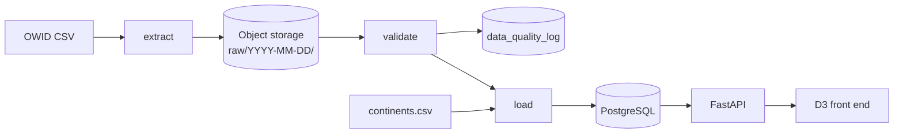

# Climate data pipeline


A small, containerised data platform that ingests an open climate dataset, validates it, stores it, and serves it through an API and an interactive front end. It is a learning project: a miniature version of the data foundations behind public climate-science tools.


## What it does

1. **Extract:** downloads the [Our World in Data CO₂ and greenhouse gas dataset](https://github.com/owid/co2-data) and stores the untouched file in S3-compatible object storage, under a date-stamped key.
2. **Validate:** runs quality checks on the data. Hard failures stop the run before anything reaches the database. Every result is written to an audit table.
3. **Load:** upserts the cleaned data into PostgreSQL, flags aggregate entities (World, continents and so on), and exposes curated views.
4. **Serve:** a read-only FastAPI service exposes the data, the quality log and a continent-level breakdown.
5. **Explore:** a D3 front end, served by the API, shows multi-country time series and a drill-down donut chart of continent shares.



## Tech stack

Python 3.14, pandas, psycopg2, boto3 · PostgreSQL 16 · MinIO-compatible object storage · FastAPI · D3.js · Docker Compose · pytest, ruff · GitHub Actions

## Quick start

You need Docker (with Compose). Python is only needed for local development.

```bash
git clone https://github.com/verity-cook/climate-data-analysis.git
cd climate-data-analysis
cp .env.example .env        # Windows PowerShell: Copy-Item .env.example .env
# edit .env and set your own local passwords

docker compose up -d db minio
```

Open the storage console at http://localhost:9001, log in with the credentials from `.env`, and create a bucket called `climate-raw`. Then run the pipeline and start the API:

```bash
docker compose run --rm pipeline
docker compose up -d --build api
```

Open http://localhost:8000/ for the front end, or http://localhost:8000/docs for the interactive API documentation.

Everything binds to `127.0.0.1` only. PostgreSQL is mapped to host port **5433** to avoid clashing with a locally installed Postgres.

## API

| Endpoint | Description |
|---|---|
| `GET /health` | Liveness check (also tests the database connection) |
| `GET /countries` | Countries with ISO codes |
| `GET /aggregates` | Aggregate entities (World, regional groupings and so on) |
| `GET /emissions/{entity}` | Time series for a country or aggregate, with optional `start_year` / `end_year` |
| `GET /shares` | Continent-level breakdown of global CO₂ for one year, with countries per continent |
| `GET /quality/latest` | Results of the most recent pipeline's validation checks |

## Design decisions

- **Raw data is immutable and date-stamped.** Each run writes to `raw/<UTC date>/`, so any later step can be re-run from the original file.
- **Idempotent loads.** The load is an upsert keyed on `(country, year)` inside a single transaction: running it twice gives the same result, and a failure leaves nothing half-written.
- **Validation is explicit and severity-aware.** Errors (for example negative CO₂, a missing key country, a wrong row count) block the load. Warnings (stale data, a few inconsistent per-capita values) are logged only. Results are written to `data_quality_log` *before* the run fails, so failed runs leave a record.
- **Per-capita consistency check.** CO₂ divided by population should roughly match the reported per-capita value. This catches unit and join errors that range checks miss.
- **Aggregates are flagged, not mixed.** Rows without an ISO code are aggregates (World, regional groupings). A flag plus two views (`emissions_countries`, `emissions_aggregates`) makes it hard to double count by accident, while still allowing comparisons between the two kinds.
- **Continents come from a reference table.** The source has no continent column for countries, so a reviewed CSV (`src/reference/continents.csv`) is loaded into `country_continent`. International transport and any unallocated remainder are shown separately so that shares sum to the world total.
- **Parameterised SQL only.** User input reaches the database as bound parameters, never as part of the SQL text. A test guards this.
- **The API does the grouping.** `/shares` returns a ready-made hierarchy, so any client gets the same numbers as the chart.
- **Storage is swappable.** The code uses the standard S3 API through `boto3`. MinIO stopped publishing its official free Docker images, so the Compose file uses the community fork `pgsty/minio`; any S3-compatible store would work.
- **No build step for the front end.** Plain HTML, CSS and JavaScript with a pinned D3 version, served by FastAPI from the same origin, so no CORS configuration is needed.

## Data

- **Source:** [Our World in Data CO₂ and greenhouse gas emissions dataset](https://github.com/owid/co2-data), which builds on the Global Carbon Project and other sources. Licensed CC BY 4.0.
- **Units:** see the dataset's codebook (`owid-co2-codebook.csv` in the source repository) for exact column definitions.
- `co2` covers fossil fuels and cement only. `total_ghg` includes land use and forestry, so it can legitimately be negative; the front end's axis allows for this, and the non-negative validation check deliberately excludes it.
- **Continent boundaries are a convention.** Our mapping will not match the Global Carbon Project's own regional aggregates exactly (for example for countries that span regions), so continent totals are close to, not identical with, the "(GCP)" aggregates.
- Early years may include former states without ISO codes, which the chart surfaces as "Unallocated".

## Development

```bash
python -m venv .venv
.venv\Scripts\activate            # macOS/Linux: source .venv/bin/activate
pip install -r requirements.txt

python -m pytest -v               # tests need no database or object storage
ruff check .                      # lint
uvicorn src.api:app --reload      # run the API locally (stop the api container first)
```

Tests build small DataFrames in memory and replace the database layer with fakes, so they run quickly and work in CI without any services. GitHub Actions runs linting, the tests and a Docker image build on every push.

```
src/
  extract.py      download and store the raw file
  validate.py     quality checks and audit log
  load.py         clean, flag aggregates, upsert, create views
  pipeline.py     entry point: extract, then validate and load
  api.py          FastAPI app (also serves the front end)
  static/         index.html, style.css, app.js, shares.js (D3)
  reference/      continents.csv
tests/            pytest tests for validation and the API
scripts/          one-off helper to build the continent mapping
```

## Limitations and next steps

- **No authentication, rate limiting or HTTPS.** The API is bound to localhost and is not meant to be exposed publicly as it stands.
- **No scheduling or orchestration.** The pipeline runs on demand. Next step: a scheduler such as cron or an orchestrator like Airflow or Dagster.
- **Bucket creation is manual.** It should be part of the Compose setup or the pipeline's start-up.
- **No connection pooling.** The API opens a database connection per request.
- **Schema changes are hand-rolled.** A migration tool (Alembic, or dbt for transformations) would be the next step.
- **Front end has no automated tests.** It was checked manually.
- **Dev tools are in the production image.** `pytest` and `ruff` should move to a separate `requirements-dev.txt`.
- **The community MinIO fork is not a long-term answer** and has a known vulnerability in the last open-source release, so it should never be exposed to a network. A maintained S3-compatible store would be preferable beyond local use.
- **Single data source.** The structure generalises to other datasets, but only this one is implemented.
- **Versioning and locking for the raw bucket** were left off deliberately, since date-stamped keys already avoid overwrites; production use would reconsider this.
